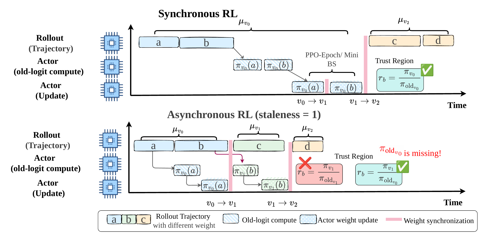
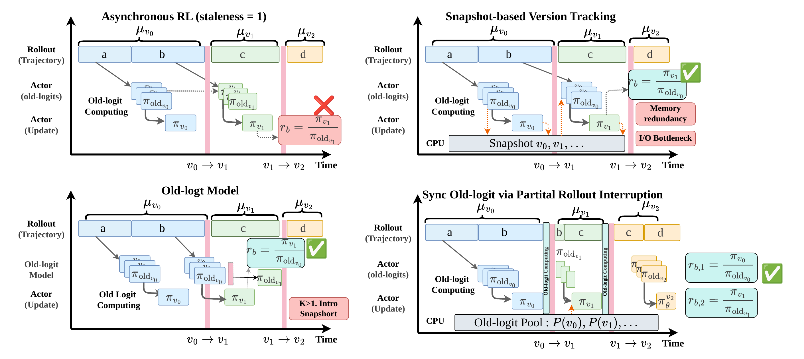
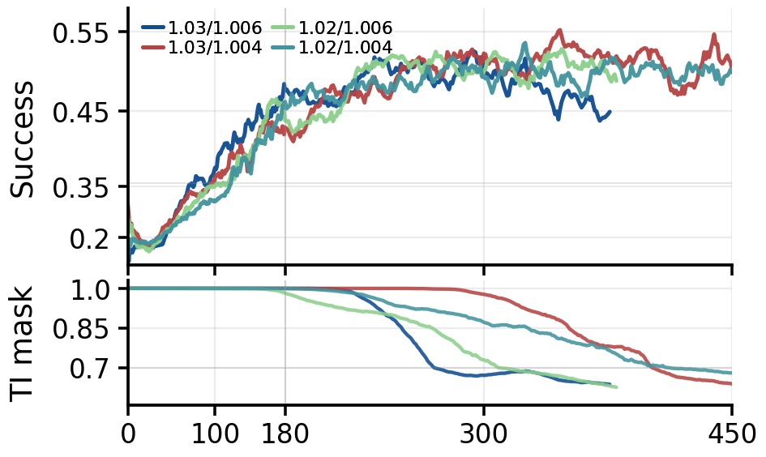
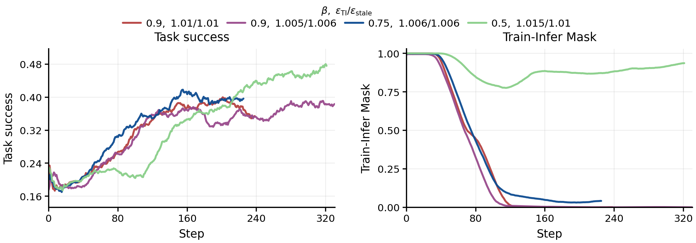
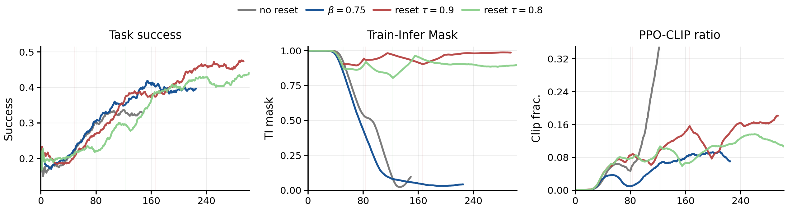

<div align="center">

# Missing Old Logits in Asynchronous Agentic RL:<br>Semantic Mismatch and Repair Methods for Off-Policy Correction

[](https://arxiv.org/abs/2605.12070)
[](https://huggingface.co/papers/2605.12070)
[](LICENSE)

</div>

<div align="center">
  <a href="#news"><b>News</b></a> ·
  <a href="#overview"><b>Overview</b></a> ·
  <a href="#method"><b>Method</b></a> ·
  <a href="#getting-started"><b>Getting Started</b></a> ·
  <a href="#citation"><b>Citation</b></a>
</div>

---

## News

- **[2026-05-13]** The project README is updated with the paper overview, released links, and implementation entry points.
- **[2026-05]** Paper released: [arXiv](https://arxiv.org/abs/2605.12070) and [Hugging Face Papers](https://huggingface.co/papers/2605.12070).

## Overview



Asynchronous reinforcement learning improves rollout throughput for large language model agents by decoupling sample generation from policy optimization. This decoupling also creates a failure mode for PPO-style off-policy correction: the historical training-side logits required for a clean correction may no longer be available when a trajectory reaches the actor.

The total importance ratio should ideally separate two effects:

- **Training-inference discrepancy:** the numerical gap between inference-side rollout probabilities and training-side forward probabilities at the same behavior-policy version.
- **Policy staleness:** the update gap between the historical behavior policy and the current train policy.

When old training-side logits are missing, these two effects become entangled. Discrepancy masks and PPO clipping then operate on a semantically mixed ratio, causing threshold choices to interfere with each other and making asynchronous training harder to tune.

This repository contains the ROLL-based implementation used to study and repair this missing-old-logit problem. It keeps the async rollout/training paths, train-infer correction utilities, snapshot-based old-logprob recomputation, and EWMA-style proximal reference policies used by the paper.

## Method



We study two complementary directions.

- **Exact old-logit acquisition:** recover semantically correct old logits through system support. The paper analyzes snapshot-based version tracking, a dedicated old-logit model, and synchronization through partial rollout interruption.
- **Low-cost approximate correction:** when exact old logits are too expensive, use a revised PPO-EWMA reference policy to preserve most of the benefit of decoupled correction without introducing heavy system overhead.

The implementation in this branch focuses on the practical routes below.

| Route | Purpose |
| --- | --- |
| `snapshot_old` | Exact correction through actor snapshots and version-aware old log-prob recomputation. |
| `current_recompute` | A simple baseline that recomputes old log-probs from the current train actor. |
| `interp_prox_loglinear` | A log-linear proximal reference used as an approximation baseline. |
| `ewma_prox` | An EWMA proximal reference for lower-overhead off-policy correction. |
| `ppo_ewma_async` | An EWMA-based reference-policy variant for asynchronous training. |

## Results

PPO-EWMA is the strongest practical method in the main benchmark table. Snapshot is included as an idealized exact-recovery reference because it assumes exact old logits are available.

| Backbone | Method | Retail avg@4 | Retail pass@4 | Airline avg@4 | Airline pass@4 | Telecom avg@2 | Telecom pass@2 | Vita In-store avg@2 | Vita In-store pass@2 | Vita Delivery avg@2 | Vita Delivery pass@2 |
| --- | --- | ---: | ---: | ---: | ---: | ---: | ---: | ---: | ---: | ---: | ---: |
| Qwen3-4B | Decoupled PPO | 63.96 | 88.60 | 53.5 | 72 | 40 | 50 | 19.83 | 37 | 19.56 | 33 |
| Qwen3-4B | Linear_prox | 64.40 | 86.84 | 54 | 72 | 37.5 | 50 | 22.37 | 40 | 19.10 | 28 |
| Qwen3-4B | PPO-EWMA | **65.72** | **90.35** | **54** | **74** | **42.5** | **52.5** | **25** | **50** | **25.88** | **39** |
| Qwen3-4B | Snapshot† | 66.23 | 89.47 | 56 | 76 | 42.5 | 52.5 | 28.89 | 47 | 27.33 | 42 |
| Qwen3-30B-A3B | Decoupled PPO | 65.43 | 89.47 | 57 | 76 | 44.75 | 55 | 18.28 | 32 | 25.88 | 39 |
| Qwen3-30B-A3B | Linear_prox | 65.8 | 87.7 | 53.5 | 74 | 44 | 55 | 31.47 | 47 | 20.74 | 33 |
| Qwen3-30B-A3B | PPO-EWMA | **67.82** | **92.1** | **60** | **82** | **45** | **57.5** | **33.41** | **48** | **28.49** | **43** |
| Qwen3-30B-A3B | Snapshot† | 69.70 | 92.1 | 59 | 80 | 45 | 57.5 | 34.62 | 50 | 30.74 | 45 |

On the dense 4B model, PPO-EWMA obtains the best practical retail pass@4 and VitaBench in-store pass@2, while tying the best telecom scores. On the 30B MoE model, it is strongest on airline and ties the best practical retail pass@4 and telecom avg@2.

The cost comparison also explains why exact recovery is not always the practical choice.

| Method | 4B CPU storage | 30B CPU storage | 4B extra time | 30B extra time |
| --- | ---: | ---: | ---: | ---: |
| Snapshot | 40 GB | 76.4 GB | 25 s | 150 s |
| PPO-EWMA | 7.9 GB | 15.2 GB | 8 s | 34 s |



The experiments show a consistent trade-off: stricter discrepancy and staleness thresholds filter more mismatched tokens and stabilize training, while looser settings improve early optimization speed but can accumulate unstable updates later.



PPO-EWMA provides a practical middle ground. It constructs a smoother reference from historical policies, and the asynchronous variant uses staleness-aware decay selection and auto-reset to avoid excessive stale-policy accumulation.



## Getting Started

Pull the prepared Docker image:

```bash
docker pull roll-registry.cn-hangzhou.cr.aliyuncs.com/roll/pytorch:nvcr-25.06-py3-torch280-vllm0110
```

Start the container. Replace `<path-to-ROLL>` with the absolute path to this repository on your machine.

```bash
docker run -itd --name ROLL \
  --network host \
  --ipc host \
  -p 127.0.0.1:5007:5007 \
  --gpus all \
  -e PYTHONPATH=/ROLL \
  -v <path-to-ROLL>:/ROLL \
  --entrypoint /bin/bash \
  roll-registry.cn-hangzhou.cr.aliyuncs.com/roll/pytorch:nvcr-25.06-py3-torch280-vllm0110
```

Install the local adapter and SGLang dependencies inside the container:

```bash
docker exec -it ROLL bash
cd /ROLL/mcore_adapter
pip install -e .
pip install "sglang[srt,torch-memory-saver]==0.5.2"
```

Experiment configs are collected under [examples/fixed_async_offpolicy](examples/fixed_async_offpolicy). They cover snapshot-based recovery, current-policy recomputation, log-linear proximal references, and EWMA-based asynchronous variants.

Key implementation paths:

- [roll/pipeline/base_pipeline.py](roll/pipeline/base_pipeline.py): old log-prob source selection and snapshot / EWMA handling.
- [roll/pipeline/agentic/agentic_pipeline.py](roll/pipeline/agentic/agentic_pipeline.py): agentic training pipeline.
- [roll/distributed/scheduler/rollout_scheduler.py](roll/distributed/scheduler/rollout_scheduler.py): rollout scheduling and async batch flow.
- [roll/utils/train_infer_corrections.py](roll/utils/train_infer_corrections.py): train-infer correction logic.

This branch does not carry the dedicated `actor_old_logit` / `old_logit_model` implementation path.

## Citation

```bibtex
@article{guan2026missing,
  title={Missing Old Logits in Asynchronous Agentic RL: Semantic Mismatch and Repair Methods for Off-Policy Correction},
  author={Guan, Zhong and Guo, Yongjian and Sun, Haoran and Huang, Wen and Di, Shuai and Wu, Xiong Jun and Wu, Likang and Zhao, Hongke},
  journal={arXiv preprint arXiv:2605.12070},
  year={2026}
}
```

## License

This repository continues to use the upstream Apache 2.0 license. See [LICENSE](LICENSE).
