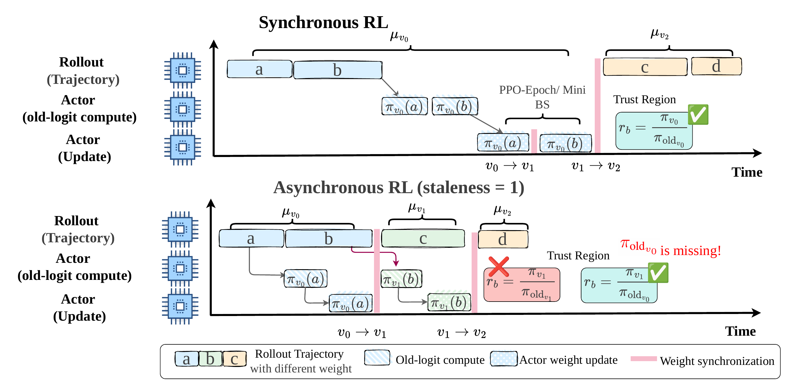
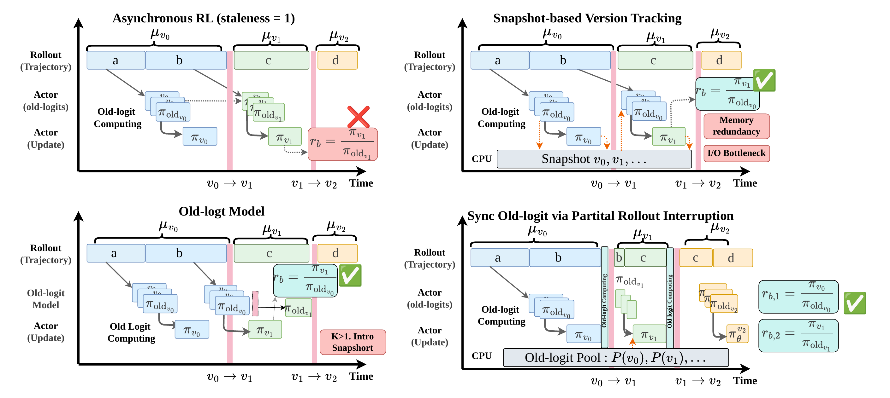
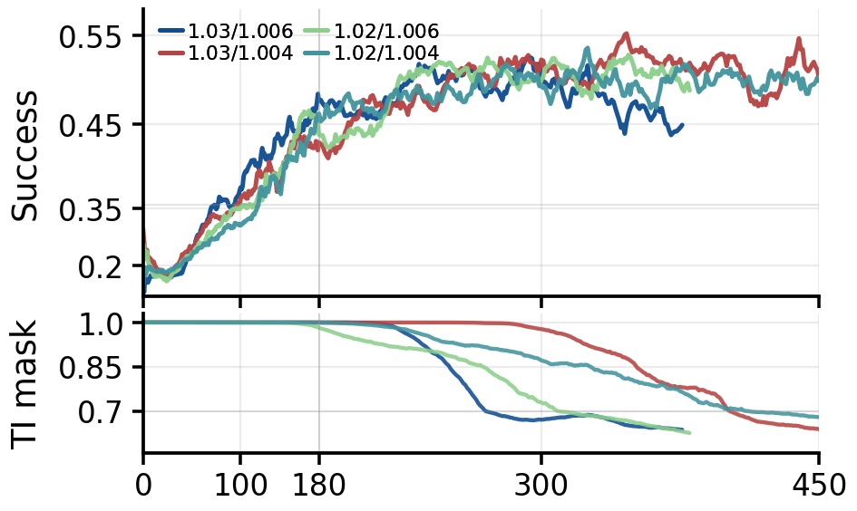
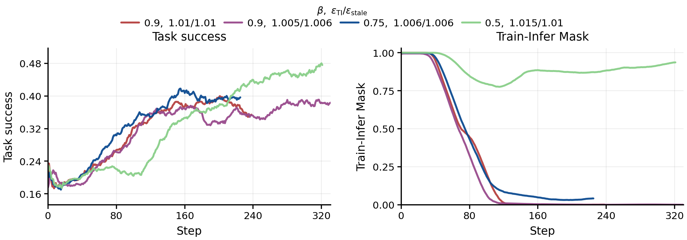
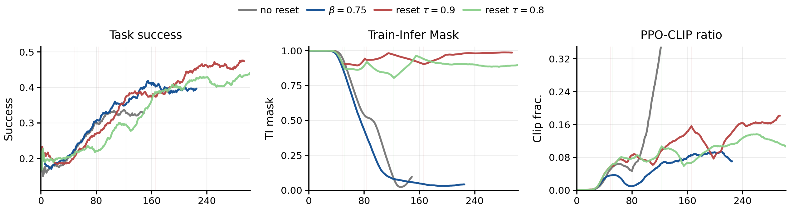

<div align="center">

# Missing Old Logits in Asynchronous Agentic RL:<br>Semantic Mismatch and Repair Methods for Off-Policy Correction

[](https://arxiv.org/abs/2605.12070)
[](https://huggingface.co/papers/2605.12070)
[](LICENSE)

</div>

<div align="center">
  <a href="#最新动态"><b>最新动态</b></a> ·
  <a href="#概览"><b>概览</b></a> ·
  <a href="#方法"><b>方法</b></a> ·
  <a href="#快速开始"><b>快速开始</b></a> ·
  <a href="#引用"><b>引用</b></a>
</div>

---

## 最新动态

- **[2026-05-13]** README 已更新为论文项目页风格，补充论文链接、问题概览、方法说明和实现入口。
- **[2026-05]** 论文已发布：[arXiv](https://arxiv.org/abs/2605.12070) 和 [Hugging Face Papers](https://huggingface.co/papers/2605.12070)。

## 概览



异步强化学习通过解耦 rollout 生成和 policy 优化，提升了大语言模型智能体训练的吞吐。但这种解耦也给 PPO 风格的 off-policy correction 带来一个关键问题：当轨迹到达 actor 侧时，用于干净修正的历史 train-side old logits 可能已经不可用了。

理想情况下，总 importance ratio 应该拆成两个语义不同的部分：

- **训推不一致修正：** 对齐同一个历史行为策略版本下，inference-side rollout 概率和 training-side forward 概率之间的数值差异。
- **策略陈旧性修正：** 约束历史行为策略到当前训练策略之间的更新幅度。

当 old training-side logits 缺失时，这两个效应会被混进同一个 ratio。此时 discrepancy mask 和 PPO clipping 会作用在语义不干净的 ratio 上，导致 threshold 互相干扰，异步训练也更难调。

这个仓库包含论文中使用的 ROLL-based 实现，保留了异步 rollout / training 路径、train-infer correction 工具、基于 snapshot 的 old log-prob 重算，以及 EWMA-style proximal reference policy。

## 方法



论文研究了两条互补路线：

- **精确 old-logit 获取：** 通过系统支持恢复语义正确的 old logits。论文分析了 snapshot-based version tracking、dedicated old-logit model，以及 partial rollout interruption 三种路线。
- **低开销近似修正：** 当精确 old logits 的系统成本过高时，使用 revised PPO-EWMA reference policy，在尽量不引入额外系统开销的情况下保留 decoupled correction 的主要收益。

当前分支中的主要实现路线如下：

| Route | 用途 |
| --- | --- |
| `snapshot_old` | 通过 actor snapshot 和按版本重算 old log-prob，提供精确修正。 |
| `current_recompute` | 直接用当前 train actor 重算 old log-probs，作为简单 baseline。 |
| `interp_prox_loglinear` | 使用 log-linear proximal reference，作为近似 baseline。 |
| `ewma_prox` | 使用 EWMA proximal reference，降低 off-policy correction 开销。 |
| `ppo_ewma_async` | 面向异步训练的 EWMA reference-policy 变体。 |

## 实验结果

PPO-EWMA 是主实验表中最强的 practical method。Snapshot 作为 idealized exact-recovery reference，因为它假设 exact old logits 可用。

| Backbone | Method | Retail avg@4 | Retail pass@4 | Airline avg@4 | Airline pass@4 | Telecom avg@2 | Telecom pass@2 | Vita In-store avg@2 | Vita In-store pass@2 | Vita Delivery avg@2 | Vita Delivery pass@2 |
| --- | --- | ---: | ---: | ---: | ---: | ---: | ---: | ---: | ---: | ---: | ---: |
| Qwen3-4B | Decoupled PPO | 63.96 | 88.60 | 53.5 | 72 | 40 | 50 | 19.83 | 37 | 19.56 | 33 |
| Qwen3-4B | Linear_prox | 64.40 | 86.84 | 54 | 72 | 37.5 | 50 | 22.37 | 40 | 19.10 | 28 |
| Qwen3-4B | PPO-EWMA | **65.72** | **90.35** | **54** | **74** | **42.5** | **52.5** | **25** | **50** | **25.88** | **39** |
| Qwen3-4B | Snapshot† | 66.23 | 89.47 | 56 | 76 | 42.5 | 52.5 | 28.89 | 47 | 27.33 | 42 |
| Qwen3-30B-A3B | Decoupled PPO | 65.43 | 89.47 | 57 | 76 | 44.75 | 55 | 18.28 | 32 | 25.88 | 39 |
| Qwen3-30B-A3B | Linear_prox | 65.8 | 87.7 | 53.5 | 74 | 44 | 55 | 31.47 | 47 | 20.74 | 33 |
| Qwen3-30B-A3B | PPO-EWMA | **67.82** | **92.1** | **60** | **82** | **45** | **57.5** | **33.41** | **48** | **28.49** | **43** |
| Qwen3-30B-A3B | Snapshot† | 69.70 | 92.1 | 59 | 80 | 45 | 57.5 | 34.62 | 50 | 30.74 | 45 |

在 dense 4B 模型上，PPO-EWMA 取得了 practical methods 中最好的 retail pass@4 和 VitaBench in-store pass@2，并在 telecom 上打平最好结果。在 30B MoE 模型上，PPO-EWMA 在 airline 上最强，并打平 practical methods 中最好的 retail pass@4 和 telecom avg@2。

系统开销也说明了为什么 exact recovery 不总是实践中的最优选择。

| Method | 4B CPU storage | 30B CPU storage | 4B extra time | 30B extra time |
| --- | ---: | ---: | ---: | ---: |
| Snapshot | 40 GB | 76.4 GB | 25 s | 150 s |
| PPO-EWMA | 7.9 GB | 15.2 GB | 8 s | 34 s |



实验中可以看到稳定性和速度之间的典型权衡：更严格的 discrepancy / staleness thresholds 会过滤更多 mismatch tokens，使训练更稳定；更宽松的设置能提升早期优化速度，但后期更容易积累不稳定更新。



PPO-EWMA 是一个实践上更均衡的选择。它从历史策略中构造平滑 reference，异步版本进一步加入 staleness-aware decay selection 和 auto-reset，避免 stale-policy 影响过度累积。



## 快速开始

拉取预构建 Docker 镜像：

```bash
docker pull roll-registry.cn-hangzhou.cr.aliyuncs.com/roll/pytorch:nvcr-25.06-py3-torch280-vllm0110
```

启动容器。请将 `<path-to-ROLL>` 替换为本机当前仓库的绝对路径。

```bash
docker run -itd --name ROLL \
  --network host \
  --ipc host \
  -p 127.0.0.1:5007:5007 \
  --gpus all \
  -e PYTHONPATH=/ROLL \
  -v <path-to-ROLL>:/ROLL \
  --entrypoint /bin/bash \
  roll-registry.cn-hangzhou.cr.aliyuncs.com/roll/pytorch:nvcr-25.06-py3-torch280-vllm0110
```

进入容器后安装本地 adapter 和 SGLang 依赖：

```bash
docker exec -it ROLL bash
cd /ROLL/mcore_adapter
pip install -e .
pip install "sglang[srt,torch-memory-saver]==0.5.2"
```

实验配置集中放在 [examples/fixed_async_offpolicy](examples/fixed_async_offpolicy)。其中覆盖了基于 snapshot 的恢复、current-policy 重算、log-linear proximal reference，以及基于 EWMA 的异步训练变体。

关键实现路径：

- [roll/pipeline/base_pipeline.py](roll/pipeline/base_pipeline.py)：old log-prob source 选择逻辑，以及 snapshot / EWMA 处理逻辑。
- [roll/pipeline/agentic/agentic_pipeline.py](roll/pipeline/agentic/agentic_pipeline.py)：agentic 训练主 pipeline。
- [roll/distributed/scheduler/rollout_scheduler.py](roll/distributed/scheduler/rollout_scheduler.py)：rollout 调度和异步 batch 流程。
- [roll/utils/train_infer_corrections.py](roll/utils/train_infer_corrections.py)：训推修正逻辑。

这个分支不包含专门的 `actor_old_logit` / `old_logit_model` 实现路径。

## 引用

```bibtex
@article{guan2026missing,
  title={Missing Old Logits in Asynchronous Agentic RL: Semantic Mismatch and Repair Methods for Off-Policy Correction},
  author={Guan, Zhong and Guo, Yongjian and Sun, Haoran and Huang, Wen and Di, Shuai and Wu, Xiong Jun and Wu, Likang and Zhao, Hongke},
  journal={arXiv preprint arXiv:2605.12070},
  year={2026}
}
```

## 许可证

这个仓库继续沿用上游 Apache 2.0 许可证。详见 [LICENSE](LICENSE)。
